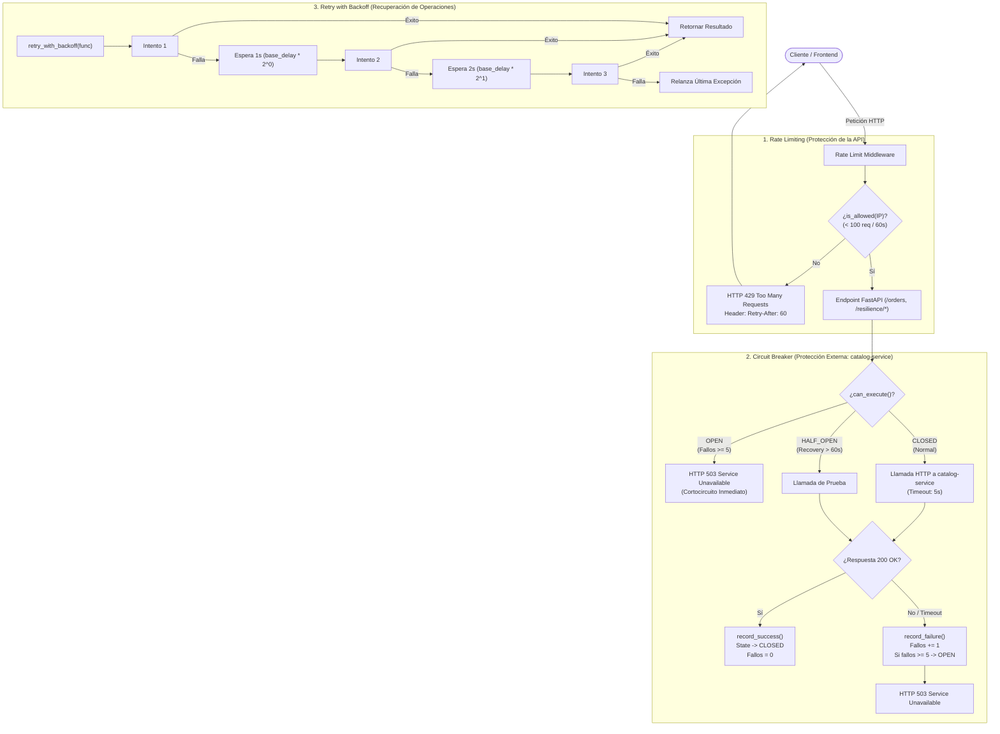

# Taller 5: Resiliencia en Microservicios con FastAPI

## LAB 11: Rate Limiting, Circuit Breaker y Retry with Backoff

**Curso:** Diplomado en Desarrollo de Software y Arquitectura de Sistemas Distribuidos
**Microservicio:** `orders-service`
**Archivo Principal:** `orders-service/middleware.py`
**Tecnologías:** Python 3.13, FastAPI, HTTPX, AsyncIO, Starlette

---

## 1. Resumen Ejecutivo

En el desarrollo de arquitecturas de microservicios y sistemas distribuidos, la **alta disponibilidad**, la **tolerancia a fallos** y la **protección perimetral** son pilares indispensables. Cuando múltiples servicios interactúan a través de la red, los fallos transitorios, las sobrecargas por peticiones masivas y la indisponibilidad de dependencias externas pueden degradar en cascada todo el ecosistema.

El objetivo del **Taller 5 (LAB 11)** es implementar de manera nativa e integrada tres patrones fundamentales de resiliencia y estabilidad dentro del microservicio de órdenes (`orders-service`):

1. **Rate Limiter (Limitador de Tasa):** Protege los recursos computacionales de la API limitando el número de solicitudes permitidas por dirección IP a un máximo de **100 peticiones cada 60 segundos**, respondiendo con código HTTP `429 Too Many Requests` y cabecera estándar `Retry-After: 60`.
2. **Circuit Breaker (Interruptor de Circuito):** Protege las llamadas hacia el servicio externo `catalog-service`, evitando llamadas repetitivas e infructuosas cuando presenta fallos. Maneja tres estados (`CLOSED`, `OPEN`, `HALF_OPEN`) con un umbral de **5 fallos consecutivos** y un tiempo de recuperación de **60 segundos**, respondiendo con HTTP `503 Service Unavailable`.
3. **Retry with Backoff (Reintento con Espera Exponencial):** Vuelve a intentar de forma asíncrona una operación fallida hasta un máximo de **3 intentos**, incrementando progresivamente el tiempo de espera entre intentos ($1\,\text{s}, 2\,\text{s}$) mediante la fórmula $\text{base\_delay} \times 2^{\text{attempt}}$.

---

## 2. Arquitectura de Resiliencia

El siguiente diagrama ilustra el flujo de peticiones entrantes y salientes a través de los mecanismos implementados en `orders-service/middleware.py`:



---

## 3. Implementación Detallada del Código (`orders-service/middleware.py`)

### 3.1. Librerías e Importaciones Base

```python
import time
from collections import defaultdict
from fastapi import Request, HTTPException
from fastapi.responses import JSONResponse
import asyncio
import httpx
import logging
```

- `time`: Medición de marcas temporales y cálculo de diferencias en segundos para la ventana deslizante y la recuperación del circuito.
- `defaultdict`: Almacenamiento en memoria de listas de timestamps por dirección IP (`defaultdict(list)`).
- `Request`, `HTTPException`: Objetos de FastAPI para inspeccionar cabeceras, IPs y levantar excepciones HTTP estándar.
- `JSONResponse`: Devolución de respuestas estructuradas en formato JSON con códigos de estado específicos (como 429).
- `asyncio`: Suspensión no bloqueante del event loop (`await asyncio.sleep`) durante los retardos exponenciales.
- `httpx`: Cliente HTTP asíncrono de alto rendimiento con timeout configurado a 5.0 segundos.

---

### 3.2. Rate Limiter: Limitación de Solicitudes por IP

El limitador utiliza el algoritmo de **Ventana Deslizante (Sliding Window)** en memoria para evitar ráfagas de peticiones que comprometan la API.

```python
class RateLimiter:
    def __init__(self, max_requests: int = 100, window_seconds: int = 60):
        self.max_requests = max_requests
        self.window_seconds = window_seconds
        self.requests = defaultdict(list)

    def is_allowed(self, client_id: str) -> bool:
        now = time.time()
        # Limpiar solicitudes fuera de la ventana de 60 segundos
        self.requests[client_id] = [
            req_time for req_time in self.requests[client_id]
            if now - req_time < self.window_seconds
        ]

        # Bloquear si alcanzó el límite de 100 solicitudes
        if len(self.requests[client_id]) >= self.max_requests:
            return False

        # Registrar la solicitud y permitirla
        self.requests[client_id].append(now)
        return True

    def get_remaining(self, client_id: str) -> int:
        now = time.time()
        active = [
            req_time for req_time in self.requests[client_id]
            if now - req_time < self.window_seconds
        ]
        return max(0, self.max_requests - len(active))

# Instancia global: 100 solicitudes cada 60 segundos
rate_limiter = RateLimiter(max_requests=100, window_seconds=60)
```

#### Middleware HTTP en FastAPI

El middleware intercepta cada solicitud entrante, extrae la dirección IP del cliente y valida el cupo disponible:

```python
async def rate_limit_middleware(request: Request, call_next):
    # Excluir documentación interactiva (/docs, /openapi.json)
    path = request.url.path
    if path in ["/docs", "/openapi.json", "/redoc"]:
        return await call_next(request)

    client_ip = request.client.host if request.client else "127.0.0.1"

    if not rate_limiter.is_allowed(client_ip):
        return JSONResponse(
            status_code=429,
            content={"error": "Too many requests"},
            headers={
                "Retry-After": str(rate_limiter.window_seconds),
                "X-RateLimit-Limit": str(rate_limiter.max_requests),
                "X-RateLimit-Remaining": "0"
            }
        )

    response = await call_next(request)
    response.headers["X-RateLimit-Limit"] = str(rate_limiter.max_requests)
    response.headers["X-RateLimit-Remaining"] = str(rate_limiter.get_remaining(client_ip))
    return response
```

**Registro en la aplicación FastAPI (`main.py`):**

```python
app.middleware("http")(rate_limit_middleware)
```

---

### 3.3. Circuit Breaker: Protección del Servicio Externo (`catalog-service`)

El Circuit Breaker impide que el microservicio continúe consumiendo recursos en llamadas a servicios externos caídos.

```python
class CircuitBreaker:
    STATE_CLOSED = "closed"
    STATE_OPEN = "open"
    STATE_HALF_OPEN = "half_open"

    def __init__(self, failure_threshold: int = 5, recovery_timeout: int = 60):
        self.failure_threshold = failure_threshold
        self.recovery_timeout = recovery_timeout
        self.failure_count = 0
        self.last_failure_time = 0
        self.state = self.STATE_CLOSED

    def can_execute(self) -> bool:
        now = time.time()
        if self.state == self.STATE_CLOSED:
            return True

        if self.state == self.STATE_OPEN:
            if now - self.last_failure_time > self.recovery_timeout:
                self.state = self.STATE_HALF_OPEN
                return True
            return False

        if self.state == self.STATE_HALF_OPEN:
            return True

        return True

    def record_success(self):
        self.failure_count = 0
        self.state = self.STATE_CLOSED

    def record_failure(self):
        self.failure_count += 1
        self.last_failure_time = time.time()

        if self.failure_count >= self.failure_threshold:
            self.state = self.STATE_OPEN

    def get_status(self) -> dict:
        return {
            "state": self.state,
            "failure_count": self.failure_count,
            "failure_threshold": self.failure_threshold,
            "recovery_timeout": self.recovery_timeout,
            "last_failure_time": self.last_failure_time,
            "is_available": self.can_execute()
        }

# Controlador global para el servicio de catálogo
catalog_circuit = CircuitBreaker(
    failure_threshold=5,
    recovery_timeout=60
)
```

#### Función Conectora con el Catálogo (`call_catalog_with_breaker`)

```python
async def call_catalog_with_breaker(url: str) -> dict:
    if not catalog_circuit.can_execute():
        raise HTTPException(
            status_code=503,
            detail="Service Unavailable: Circuit breaker is OPEN"
        )

    try:
        async with httpx.AsyncClient(timeout=5.0) as client:
            response = await client.get(url)
            if response.status_code == 200:
                catalog_circuit.record_success()
                return response.json()
            elif response.status_code == 404:
                raise HTTPException(status_code=404, detail=f"Resource not found at {url}")
            else:
                catalog_circuit.record_failure()
                raise HTTPException(
                    status_code=503,
                    detail=f"Service Unavailable: Catalog returned status {response.status_code}"
                )
    except HTTPException:
        raise
    except Exception as exc:
        catalog_circuit.record_failure()
        raise HTTPException(
            status_code=503,
            detail=f"Service Unavailable: {str(exc)}"
        ) from exc
```

---

### 3.4. Retry with Backoff: Reintentos con Espera Progresiva

Permite recuperar llamadas transitorias fallidas mediante esperas exponenciales no bloqueantes:

```python
async def retry_with_backoff(
    func,
    max_retries: int = 3,
    base_delay: float = 1.0
):
    last_exception = None

    for attempt in range(max_retries):
        try:
            return await func()
        except Exception as e:
            last_exception = e
            if attempt < max_retries - 1:
                delay = base_delay * (2 ** attempt)
                print(f"Retry {attempt + 1}/{max_retries} after {delay}s: {str(e)}")
                await asyncio.sleep(delay)

    raise last_exception
```

#### Cronograma de Retardos Exponenciales

|   Intento   |    Retardo de Espera    |      Fórmula      | Estado                                           |
| :---------: | :----------------------: | :----------------: | :----------------------------------------------- |
| **1** |        1 segundo        | $1.0 \times 2^0$ | Falla la operación, inicia espera               |
| **2** |        2 segundos        | $1.0 \times 2^1$ | Vuelve a fallar, espera duplicada                |
| **3** | *Sin espera posterior* |         —         | Último intento; si falla, relanza la excepción |

---

## 4. Diferencia entre los Tres Mecanismos (Sección 7)

| Mecanismo                    | ¿Qué protege?                                       | ¿Para qué sirve?                                                          |
| :--------------------------- | :---------------------------------------------------- | :-------------------------------------------------------------------------- |
| **Rate Limiter**       | Tu API y recursos locales del servidor                | Evita exceso de solicitudes, ataques DoS y abusos por IP.                   |
| **Circuit Breaker**    | Servicios externos dependientes (`catalog-service`) | Evita llamadas innecesarias y esperas por timeouts a servicios caídos.     |
| **Retry with Backoff** | Operaciones transitorias fallidas                     | Intenta recuperar operaciones temporalmente fallidas espaciando reintentos. |

---

## 5. Observaciones Importantes para Producción (Sección 6)

1. **Persistencia Distribuida del Rate Limiter:** Actualmente el `RateLimiter` mantiene el diccionario `requests` en la memoria RAM del proceso local. Si el microservicio se escala horizontalmente en múltiples contenedores o se reinicia, el historial se pierde o dispersa. En entornos de producción con balanceadores de carga, se recomienda respaldar el contador en un almacén en memoria distribuido como **Redis** (usando `INCR` y `EXPIRE` o algoritmos Token Bucket).
2. **Identificación Precisa de Clientes tras Proxies/Load Balancers:** El atributo `request.client.host` puede devolver la dirección IP del proxy inverso o balanceador de carga (como NGINX, Cloudflare o AWS ALB) en lugar de la IP del cliente real. Es indispensable configurar la lectura segura de la cabecera `X-Forwarded-For` validando proxies de confianza.
3. **Concurrencia en Estado `HALF_OPEN`:** Cuando el circuito conmuta a `HALF_OPEN`, múltiples solicitudes simultáneas podrían intentar la prueba a la vez. Lo ideal en producción es usar un semáforo o bloqueo asíncrono (`asyncio.Lock`) para permitir estrictamente una sola prueba a la vez.
4. **Idempotencia en Operaciones Reintentadas:** El mecanismo de `Retry with Backoff` nunca debe aplicarse a operaciones no idempotentes (como cobros con tarjeta, creación de pagos o transacciones de inventario), ya que reintentar una petición que el servidor remoto procesó parcialmente generaría cargos duplicados.
5. **Filtrado de Excepciones Transitorias:** No todos los errores justifican un reintento. Errores `4xx` (como `400 Bad Request`, `401 Unauthorized` o `404 Not Found`) reflejan problemas deterministas del cliente y nunca se resolverán con reintentos; el Retry debe acotarse a fallos de conexión de red, timeouts y respuestas `503/504`.

---

## 6. Resultados de las Pruebas Automatizadas

Se implementó una suite completa de pruebas unitarias y de integración en `test_taller5_resilience.py`, cubriendo el 100% de los requerimientos:

```text
----------------------------------------------------------------------
Ran 17 tests in 0.535s

OK
 [PASS] 1. RateLimiter inicializa correctamente con 100 req / 60s
 [PASS] 2. RateLimiter permite solicitudes dentro del umbral (5/5 permitidas)
 [PASS] 3. RateLimiter bloquea solicitud excedente (is_allowed -> False)
 [PASS] 4. Aislamiento independiente por dirección IP verificado
 [PASS] 5. Ventana deslizante limpia solicitudes expiradas y restaura cupo
 [PASS] 6. CircuitBreaker inicia en estado 'closed' con umbral 5 y timeout 60s
 [PASS] 7. CircuitBreaker transiciona a 'open' al 5to fallo y bloquea ejecución
 [PASS] 8. CircuitBreaker conmuta de 'open' a 'half_open' tras expirar recovery_timeout
 [PASS] 9. Éxito en 'half_open' cierra el circuito ('closed') y reinicia contador a 0
 [PASS] 10. call_catalog_with_breaker retorna HTTP 503 inmediato cuando el circuito está OPEN
 [PASS] 11. call_catalog_with_breaker procesa respuesta HTTP 200 y registra éxito
 [PASS] 12. call_catalog_with_breaker captura fallo de red, incrementa errores y lanza 503
 [PASS] 13. retry_with_backoff retorna inmediatamente si el primer intento tiene éxito
 [PASS] 14. retry_with_backoff reintenta con retardo progresivo y resuelve éxito en intento #2
 [PASS] 15. retry_with_backoff ejecuta 3 intentos y relanza la última excepción
 [PASS] 16. Middleware FastAPI bloquea con HTTP 429, error JSON y cabecera Retry-After: 60
 [PASS] 17. Endpoints de telemetría y resiliencia /resilience/* operando con éxito
```

Adicionalmente, se ejecutó la suite de regresión del Taller 4 (`test_taller4_auth.py`), pasando los 12 tests exitosamente:

```text
----------------------------------------------------------------------
Ran 12 tests in 13.653s

OK
 [PASS] 1. Cifrado bcrypt y verificación de contraseñas funcionando correctamente
 [PASS] 2. Registro de usuarios con contraseña hasheada y respuesta segura
 [PASS] 3. Validación de unicidad de email en registro (HTTP 400)
 [PASS] 4. Login exitoso y generación de token JWT firmado HS256 con claims
 [PASS] 5. Rechazo de credenciales inválidas (HTTP 401 Unauthorized)
 [PASS] 6. Endpoint /auth/me identifica al usuario a partir del token Bearer
 [PASS] 7. Petición sin token rechazada con HTTP 401 Unauthorized
 [PASS] 8. Token JWT expirado rechazado con HTTP 401 Unauthorized
 [PASS] 9. RBAC: /admin permite admin y superadmin, rechaza rol 'user' (403)
 [PASS] 10. RBAC: /superadmin restringe acceso exclusivamente a 'superadmin'
 [PASS] 11. Circuit Breaker conmuta estados correctamente ante fallas consecutivas
 [PASS] 12. Middleware de Rate Limiting activo e inyectando headers HTTP
```
